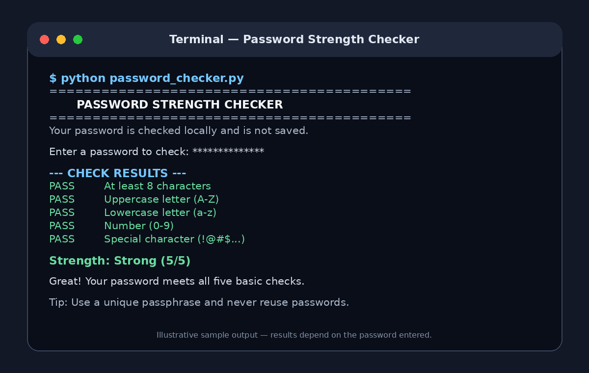

# Password Strength Checker

A beginner-friendly Python project that checks a password against five basic security rules and labels it **Weak**, **Medium**, or **Strong**.

## Features
- Checks minimum length (8 characters)
- Checks for uppercase and lowercase letters
- Checks for at least one number
- Checks for at least one special character
- Displays a score out of 5 and suggestions for missing requirements
- Uses `getpass` so the password is not echoed on the terminal
- Does not save or transmit the password

## Requirements
- Python 3.8 or later
- No external libraries required

## How to Run
1. Download or clone this repository.
2. Open a terminal in the project folder.
3. Run:

```bash
python password_checker.py
```

On some systems, use `python3 password_checker.py`.

## Sample Output

The screenshot below is an illustrative example using a sample password. Your results will depend on the password you enter.



## Strength Rules

| Score | Result |
|---:|---|
| 0–2 | Weak |
| 3–4 | Medium |
| 5 | Strong |

## Project Files

```text
password-strength-checker/
├── password_checker.py
├── README.md
└── output.png
```

## Important Note
This is a learning project and a basic rule-based checker. A “Strong” result does not guarantee that a password is safe. Use long, unique passwords or passphrases, avoid personal information and common patterns, and enable multi-factor authentication where available.
